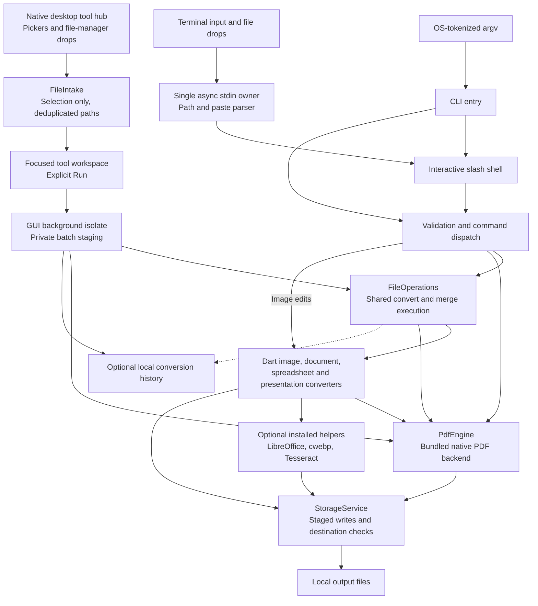

# Converto

**Convert and edit files on your own machine. Offline, private, and without conversion quotas.**

Converto is a local file conversion toolkit for documents, images, spreadsheets, presentations, and PDFs. Use ordinary terminal commands, open the interactive slash-command menu, or drop file paths into the terminal. Files are processed on your device, with no upload service, account, or telemetry client.

The CLI has **25 operations**, **21 registered source extensions**, and **114 tested source/target pairs**. Native builds and automated verification run on **macOS arm64, Windows x64, and Linux x64**. Native macOS, Windows and Linux app previews add a searchable tool hub and focused workspaces on top of the same local engine.

[Installation](#installation) · [Usage](#usage) · [Operations](#all-25-operations) · [Formats](#supported-formats) · [Architecture](#architecture) · [Analytics](#verified-analytics) · [Development](#development-and-verification)

## The eight cornerstones

| Cornerstone | What it means in Converto |
|---|---|
| **Always offline** | Conversion runs locally, including optional installed helpers. The complete local macOS acceptance suite passed with networking denied. Installing the SDK, dependencies, or helpers is a separate setup step that can use the network. |
| **Privacy first** | No file uploads, conversion API, telemetry, or account service. Outputs, temporary work, and optional conversion history stay on your device. History stores filenames and paths and can be disabled. |
| **Resource efficient** | A native Dart CLI with bundled PDF libraries. Original JPEG data is embedded directly into PDFs; unnecessary image encode/decode cycles and duplicate PDF parsing are avoided. |
| **Storage friendly** | Temporary conversion work is cleaned up, destination writes are staged, PDF compression retains the original result when recompression would grow it, and new history writes retain at most 1,000 records. |
| **No quotas or rate limits** | No conversion counter, daily allowance, or hosted processing queue. Batches run sequentially against your available local resources. |
| **No signups** | Running the CLI requires no Converto account, login, or license activation. Accessing this currently private GitHub repository or its CI artifacts requires repository access. |
| **No artificial file-size cap** | There is no product upload limit or application file-size quota. RAM, disk, codec dimensions, helper timeouts, and OS limits still apply; several parsers hold whole files in memory. |
| **Fast local processing** | No server round trip. Measured samples improved JPEG-to-PDF by about **45×** and text-to-PDF by about **15×**; other measured workloads were effectively unchanged. See the benchmark conditions below. |

## macOS app preview

The native Flutter app offers **20 file tools**: conversion, image editing, scanned PDF creation, PDF
merge/split/extract/organize, page rotation/crop/numbers/watermark, compression,
redaction, encryption/unlock, PDF/A, Office export, text extraction and metadata.
Search or filter the tool catalog, add files with Finder drag and drop or the
native picker, then explicitly run a tool. Drops never start processing.

In **Convert files**, selecting multiple images with **PDF** output creates
**one combined PDF** by default. Arrange the file list in page order and choose
one output name before running. Choose **Separate PDFs** under **PDF output**
to save one PDF per image instead.

Use **Create scanned PDF** to adjust contrast and brightness across every page
of a PDF, or turn images and supported documents into one scanned-style PDF.
Choose color, grayscale, or black and white, compare the preview with the
original, and select 150–300 DPI for export. The output contains page images;
searchable text is not retained. Source files stay unchanged. Office inputs use
the same local converters and optional helpers as ordinary PDF conversion.

Jobs run in a background isolate, stage outputs privately, preserve originals,
and clean up failed/cancelled batches. Repeated drops deduplicate file paths.
Cancellation waits for the current local engine call to finish. Optional local
history can be disabled or cleared in Settings. The app performs no runtime
network requests, signup, uploads, telemetry or codec downloads.

Download `macos-app-AppleSilicon` (M-series Macs) or `macos-app-Intel` from a successful [native workflow run](https://github.com/debugonaut/converto/actions/workflows/build-and-release.yml).
Extract the matching `Converto-macOS-arm64.zip` or `Converto-macOS-x86_64.zip`,
then open `Converto.app`. Separate CPU downloads preserve every offline engine
while avoiding the unused architecture. The measured Apple Silicon ZIP is
**19.6 MiB**, down from **39.9 MiB**; see the [size audit](docs/audit/2026-11-01-macos-size.md).
This is an **ad-hoc signed, not notarized developer preview**, targeting macOS 13+; validate the artifact on
your Mac before distribution. Apple distribution signing/notarization is a
separate release step. Setup/builds require network access for dependencies.

Build from source on a Mac with Flutter, full Xcode and CocoaPods:

```sh
flutter pub get
flutter run -d macos
# Or build the release app:
flutter build macos --release
```

The macOS runner, UI and shared executor are in `macos/`, `lib/ui/` and
`lib/services/gui/`. Run `dart run tool/audit_gui.dart` for machine-readable
per-tool results under `build/audit/gui/results.json`; widget and worker tests
run with the ordinary Flutter test suite. The existing CLI audit below remains
separate from GUI and native-window validation. See the [Mac app audit](docs/audit/2026-11-01-macos-app.md) for per-tool results and the explicit native-interaction checks still pending.

## Windows and Linux app previews

Both desktop apps share the Mac app's **20 tools**, previews, output naming,
transactional saves and explicit Run workflow. No accounts, telemetry, runtime
codec downloads or processing quotas are added. Native manual file-manager,
dialog, display-scaling and drag/drop checks remain separate from automated tests.

| Platform | CI artifact | Package | Download size |
|---|---|---|---|
| Windows 10/11 x64 | `windows-app-x64` | `Converto-Windows-x64.zip` | 24.12 MiB |
| Linux x86_64, GTK 3, glibc 2.35+ | `linux-app-x64` | `Converto-Linux-x64.tar.gz` | 21.66 MiB |
| Debian-based Linux amd64 | `linux-app-x64` | `Converto-Linux-amd64.deb` | 15.39 MiB |

Download from a successful [native workflow run](https://github.com/debugonaut/converto/actions/workflows/build-and-release.yml).
On Windows extract the entire ZIP and open `Converto.exe`; the required C++
runtime is bundled. On Linux extract the entire tar archive and open `converto`
inside it. Keep `lib/` and `data/` beside the executable. The portable Linux app
requires neither FUSE nor zenity/kdialog. The .deb adds an application-menu entry
and a `converto-gui` launcher, leaving the CLI's `converto` command separate.

```sh
tar -xzf Converto-Linux-x64.tar.gz
./Converto/converto
# Debian/Ubuntu package alternative:
sudo apt install ./Converto-Linux-amd64.deb
```

Linux is automatically built and exercised on **Ubuntu 22.04 x86_64**; other
distributions, GNOME/KDE file-manager interactions and Wayland need a manual
pass. The app occupies **54.41 MiB**, using shared OS GTK/font/GL
libraries. Installing missing system dependencies can require network access;
file processing itself remains offline. Optional Office/WebP helpers retain
their documented requirements. See the [Linux audit](docs/audit/2026-11-01-linux-app.md)
and [Windows audit](docs/audit/2026-11-01-windows-app.md).

## Android app preview

The Android preview reuses the Flutter tool catalog and local conversion engine,
with phone navigation, app-private results, and native document import/export.
Choose local files in Android's system picker, select a tool, and explicitly run
it. Tap **Export** on each completed result to save a copy to a chosen location;
opening a result grants the selected viewer temporary read access. Cancelling a
document dialog keeps the current selection and private result intact.
Keep the app open while processing; this preview does not schedule background jobs.

Results and optional recent history stay in the app's private storage. Export
files you want to keep before uninstalling. The release manifest requests no
network or broad storage permissions. Desktop executable helpers (LibreOffice,
WebP encoding, Tesseract) are unavailable on Android; operations that require
them report a capability error. Incoming Android share/open-with intents are
outside this first preview.

Build with Flutter **3.47.9**, Java 17+, and the Android SDK. Gradle installs the
matching SDK/NDK components during setup if needed. Dependency installation uses
the network; conversion does not.

```sh
flutter pub get
flutter build apk --release --split-per-abi
python3 tool/audit_android.py --sdk "$ANDROID_HOME"
# On a connected 64-bit ARM Android device:
adb install -r build/app/outputs/flutter-apk/app-arm64-v8a-release.apk
```

The APKs are developer previews signed with the local Android debug key;
production signing and Play Store publishing are separate work. The Android
workflow builds and checks per-architecture APKs and retains them as the
`android-preview-apks` artifact. See the [Android design](docs/superpowers/specs/2026-11-01-android-app.md)
for scope and verification requirements.

## Installation

### Use a native CI bundle

There is **no published GitHub Release yet**. Linux desktop previews include a .deb; the CLI ships as a portable bundle. Verified CLI ZIPs are available from the [successful native CI run](https://github.com/debugonaut/converto/actions/runs/41276090021), or a newer successful run of [Verify and Package CLI](https://github.com/debugonaut/converto/actions/workflows/build-and-release.yml). CI artifacts have finite retention; build from source if an older artifact has expired.

1. Open the run and download the artifact for your OS. Sign in to GitHub with repository access while the repository is private.
2. Extract the downloaded artifact, then extract the `Converto-*-CLI.zip` inside it into a permanent folder.
3. Keep **`bin/` and `lib/` together**. Launch the executable below, or add its `bin/` directory to your `PATH`.

| Verified platform | Artifact | Inner CLI archive | Executable inside the archive |
|---|---|---|---|
| macOS, Apple Silicon | `cli-macOS` | `Converto-Darwin-arm64-CLI.zip` | `bin/converto` |
| Windows, x64 | `cli-Windows` | `Converto-Windows-AMD64-CLI.zip` | `bin/converto.exe` |
| Linux, x64 | `cli-Linux` | `Converto-Linux-x86_64-CLI.zip` | `bin/converto` |

macOS example, after obtaining the inner archive:

```sh
unzip Converto-Darwin-arm64-CLI.zip -d converto-cli
chmod +x converto-cli/bin/converto
./converto-cli/bin/converto --help
```

On Linux, use the same commands with `Converto-Linux-x86_64-CLI.zip`. On Windows, use PowerShell:

```powershell
Expand-Archive .\Converto-Windows-AMD64-CLI.zip -DestinationPath .\converto-cli
.\converto-cli\bin\converto.exe --help
```

A completed native bundle needs **no installed Dart, Flutter, Node.js, or Python runtime**. Copying only the executable omits required native libraries. Other CPU architectures and Linux distributions need their own compatibility validation; the table lists the configurations actually exercised by CI. Preview bundles are not signed/notarized releases.

### Build from source

Install the [Flutter SDK](https://docs.flutter.dev/install), which includes Dart, and Git. The project declares Flutter **3.38+** and Dart **3.10+**; the verified CI toolchain used Flutter **3.47.9**. The local benchmark used Dart **3.13.7**. [`dart build cli`](https://dart.dev/tools/dart-build) bundles the native code assets with the executable.

```sh
git clone https://github.com/debugonaut/converto.git
cd converto
flutter pub get
dart build cli --target bin/converto.dart --output build/local
```

Run `./build/local/bundle/bin/converto --help` on macOS/Linux, or `.\build\local\bundle\bin\converto.exe --help` in Windows PowerShell. Build on the OS/architecture you intend to run. Dependency resolution and native build hooks may download setup assets; normal conversion does not download anything.

### Optional local helpers

The core bundle handles the built-in paths listed under [Supported formats](#supported-formats). Install these helpers only for the capabilities you need:

| Helper | Adds | Discovery |
|---|---|---|
| [LibreOffice](https://www.libreoffice.org/download/) | Legacy DOC/XLS/PPT, ODP, RTF, ODT-to-PDF, and original DOCX/PPTX rendering | Standard macOS/Windows installation paths or `soffice` on `PATH` |
| [WebP utilities](https://developers.google.com/speed/webp/docs/precompiled) | Genuine WebP encoding (PDF pages and images) | `cwebp`, or ImageMagick built with WebP support, on `PATH` |
| [Tesseract OCR](https://tesseract-ocr.github.io/) | Text extraction and searchable PDFs for scanned PDFs | `tesseract` on `PATH`; language data installed separately |
| Suitable local fonts | Characters and shaping beyond the built-in Western PDF font | Installed fonts available to LibreOffice |

On Debian/Ubuntu, the full-format CI job installs:

```sh
sudo apt-get update
sudo apt-get install -y libreoffice webp fonts-noto-cjk
```

For OCR, install Tesseract and any language data you need:

```sh
brew install tesseract          # macOS
sudo apt install tesseract-ocr  # Debian/Ubuntu
```

Converto never installs helpers at runtime. Missing capabilities fail with an explicit diagnostic. Set `CONVERTO_DISABLE_HELPERS=1` for the standalone core profile, and run `converto formats` to inspect format/engine information plus OCR and WebP helper availability.

## Usage

These examples assume the selected bundle's `bin/` directory is on `PATH`. Otherwise, substitute its full executable path.

```sh
# Interactive shell: type / to discover tools, or drop file paths.
converto

# Convert an image, document, or spreadsheet.
converto convert "photo.jpg" --to pdf --output photo.pdf
converto convert "report.docx" --to pdf --output report.pdf
converto convert "budget.xlsx" --to csv --output budget.csv

# Merge PDFs and images in the specified order.
converto merge first.pdf photo.png last.pdf --output combined.pdf

# Export every PDF page, or split into groups of ten pages.
converto pdf2img report.pdf --to png --dpi 150 --output pages/
converto split report.pdf --every 10 --output parts/

# Extract selected pages and add a watermark.
converto extract report.pdf --pages 3,1 --output selected.pdf
converto watermark report.pdf --text LOCAL --output stamped.pdf

# Get command help or local processing information.
converto convert --help
converto privacy
```

### Drag and drop

Start `converto`, then drop one or more files into the terminal and press Enter. A single file opens an action menu. Multiple PDFs/images can merge in input order; other groups can convert sequentially. A dropped folder is scanned once, shallowly and in sorted order; hidden files, unsupported extensions, and symlinks are skipped.

The parser accepts quoted paths, macOS shell escapes, Windows drive/UNC paths and PowerShell quoting, and local `file://` URIs. Spaces, apostrophes, punctuation, Unicode, CRLF, multiline pastes, and repeated drops have regression coverage. Examples inside the interactive shell:

```text
/convert "report notes.txt" --to pdf --output report.pdf
/merge "first report.pdf" "photo.png" --output combined.pdf
/pdf2img "report.pdf" --to png --dpi 150 --output pages/
/help
```

Bracketed paste keeps a multiline drop together until its closing marker. Ctrl+D exits at an empty prompt; Ctrl+C interrupts supported prompt paths and restores terminal modes. Actual Finder/Explorer/Nautilus gestures and Windows ConPTY still need desktop-console validation; parser tests and piped input do not establish that coverage.

### Outputs and local history

Outputs default to `~/Documents/Converto/`, or `./Converto/` when Documents is unavailable. `--output` accepts a filename or an existing directory; a trailing separator can identify a new output directory. The filename extension must match the requested output format.

Originals are retained by default. An explicitly selected existing destination is replaced after its new content has been written successfully. Default names avoid collisions during sequential runs. Concurrent processes should use separate output paths; simultaneous default-name reservation is not coordinated.

Conversion history is local JSON, not remote analytics. It contains filenames, paths, formats, sizes, and timestamps, not passwords. Disabling new history writes does not delete earlier history.

## All 30 operations

Use slash names inside the interactive shell. Use the argv name after `converto`; `recent`, `clear`, and `exit` are shell-only actions. Per-command flags are available through `converto <command> --help`.

| Slash command | argv command | Purpose |
|---|---|---|
| `/convert` | `convert` | Convert a supported file or batch |
| `/pdf2img` | `pdf2img` | Export every PDF page as PNG/JPG/JPEG/WebP |
| `/pdf2text` | `pdf2text` | Extract PDF text, Markdown, or HTML |
| `/pdf2html` | `pdf2html` | Convert to styled HTML; `--layout` embeds exact page images |
| `/ocr` | `ocr` | OCR scans with local Tesseract; optional searchable PDF |
| `/pdf2office` | `pdf2office` | Create DOCX/XLSX/PPTX from PDF content |
| `/merge` | `merge` | Combine PDFs, images, or mixed groups |
| `/split` | `split` | Split by page count, ranges, or target size |
| `/extract` | `extract` | Keep selected pages in the requested order |
| `/organize` | `organize` | Reorder or delete PDF pages |
| `/rotate` | `rotate` | Rotate PDF pages |
| `/compare` | `compare` | Compare two PDFs; optional side-by-side HTML report |
| `/watermark` | `watermark` | Stamp text on PDF pages |
| `/page-numbers` | `page-numbers` | Add Page X of N numbering |
| `/crop` | `crop` | Trim PDF margins in points |
| `/compress` | `compress` | Compress a PDF, retaining the original if the result grows |
| `/redact` | `redact` | Remove matching PDF text spans |
| `/repair` | `repair` | Rebuild a damaged PDF; optional sanitize |
| `/pdfa` | `pdfa` | Generate PDF/A output; conformance validation remains pending |
| `/edit` | `edit-image` | Rotate, flip, and re-encode an image |
| `/protect` | `protect` | Password-protect a PDF |
| `/unlock` | `unlock` | Remove a known PDF password |
| `/sign` | `sign` | Sign with a local PKCS#12 or PEM certificate |
| `/info` | `info` | Inspect PDF metadata and page information |
| `/formats` | `formats` | List formats and conversion engines |
| `/privacy` | `privacy` | Display local processing information |
| `/recent` | — | View local conversion history |
| `/help` | `help` | Discover commands |
| `/clear` | — | Clear and redraw the terminal header |
| `/exit` | — | End the interactive session |

## Supported formats

These are the format families supported by the local engines. The original **114 source/target pairs** remain the audit baseline; the newer PDF paths (WebP, Markdown, HTML, compare, repair, signing, OCR) are covered by focused CLI tests instead of the full audit matrix. Lossless fidelity is not promised for every document.

| Source extensions | Tested conversion targets | Behavior and requirements |
|---|---|---|
| JPG, JPEG, PNG, WebP, BMP, GIF, TIFF, TIF, ICO | PDF, PNG, JPG, JPEG, WebP, BMP, TIFF, GIF, ICO | 81 pairs. WebP decoding is built in; encoding needs `cwebp`. GIF frames and TIFF pages are retained when converting to PDF. ICO entries are alternative resolutions of one icon. |
| DOCX, DOC, ODT, RTF, TXT | PDF, TXT | 10 pairs. DOC/RTF and ODT-to-PDF need LibreOffice. DOCX has a disclosed text/table fallback. |
| XLSX, XLS, CSV | PDF, CSV | 6 pairs. XLS needs LibreOffice. PDF includes every XLSX worksheet; CSV exports the first and reports that choice. |
| PPTX, PPT, ODP | PDF, PNG, JPG | 9 pairs. PPT/ODP need LibreOffice. PPTX has a disclosed text fallback. Image conversion exports the first slide. |
| PDF | PNG, JPG, JPEG, WebP, TXT, MD, HTML, DOCX, XLSX, PPTX, PDF | Bundled native engine. Generic conversion to an image exports the first page; `pdf2img` exports all pages. PDF to WebP requires a local encoder. HTML/Markdown/Office output reconstructs content; layout fidelity is not guaranteed. |

TXT/CSV support UTF-8 and BOM-marked UTF-16 LE/BE. Same-format TXT copies preserve their original bytes. Text outside the built-in Western font uses installed LibreOffice/fonts or fails clearly instead of silently dropping characters. Native PDF-to-Office output reconstructs content; original layout and editability are not guaranteed.

## Architecture

All conversion paths below execute on the local machine. The optional helper branch is a local child process, not a cloud integration.



| Boundary | Responsibility |
|---|---|
| [`lib/ui/`](lib/ui/), [`macos/`](macos/), [`windows/`](windows/), [`linux/`](linux/) | Shared desktop tool hub, native runners, picker/drop integration, history and settings |
| [`lib/services/gui/`](lib/services/gui/) | Safe file intake, background worker lifecycle, transactional batch execution and local preferences |
| [`bin/converto.dart`](bin/converto.dart) | CLI entry, argv commands, exit status, lifecycle cleanup |
| [`lib/core/terminal/`](lib/core/terminal/) | Shared asynchronous input, bracketed paste, path parsing, slash commands, terminal restoration |
| [`FileOperations`](lib/services/file_operations.dart) | Shared conversion dispatch and ordered PDF/image merging across argv, slash commands, and file drops |
| [`lib/services/converters/`](lib/services/converters/) | Format validation, local parsing, image codecs, and Office fallback selection |
| [`PdfEngine`](lib/services/pdf/pdf_engine.dart) | Native PDF manipulation, rendering, extraction, and protection |
| [`OfficeBridge`](lib/services/office_bridge.dart) / [`LocalProcess`](lib/services/local_process.dart) | Optional helper discovery, isolated Office profiles, temporary work, timeouts, and process errors |
| [`StorageService`](lib/services/storage_service.dart) / [`HistoryService`](lib/services/history_service.dart) | Local outputs, staged replacement, collision handling, and bounded optional history |

The desktop apps and CLI share the processing engines. The app stages whole GUI batches and publishes them only after success. The static landing page remains a separate surface.

## Tech stack

Versions below are from the committed dependency lockfile.

| Layer | Technology | Role |
|---|---|---|
| Desktop apps | Flutter, macOS/Windows/GTK 3 runners, `desktop_drop`, native pickers | Searchable tool catalog, focused workspaces and background isolates |
| Native CLI | Dart AOT, `args` 2.7.0, `path` 1.9.1 | Commands, filesystem handling, async terminal I/O, native executable |
| PDF generation | `pdf` 3.12.0 | Image/text/table PDF creation |
| Native PDF processing | `pdf_manipulator` **5.0.1**, pdf_oxide backend | PDF rendering, editing, merging, extraction, and security |
| Images | `image` 4.3.0 | Local image decoding, transforms, and encoding |
| Spreadsheets | `excel` 4.0.6, `csv` 6.0.0 | Workbook and CSV parsing/export |
| Office containers | `archive` 3.6.1, `xml` 6.6.1 | DOCX/PPTX/ODT container and XML handling |
| Optional helpers | LibreOffice, `cwebp`, Tesseract | Local Office rendering, WebP encoding, and OCR |
| Build and regression tests | Flutter SDK, `flutter_test` | Dependency resolution, native build hooks, Dart tests and analysis |
| Optional launcher | Node.js, built-in `child_process` | Start an already-built binary for the exact OS/architecture |
| Independent acceptance tests | Python, Pillow, PyMuPDF | Synthetic fixtures and independent content/signature checks |
| CI and landing page | GitHub Actions; HTML/CSS/JavaScript | Native build/test/package matrix; existing static website |

`pdf_manipulator` is pinned because the isolated [page-number position adapter](lib/services/pdf/page_number_bridge.dart) matches its native wire format. Dependency upgrades must retain the placement regression and native OS checks. Rust/native code is supplied by the PDF dependency's build assets; contributors normally build through Dart's hooks.

The Node launcher is optional. It never downloads binaries and never falls back to another OS/architecture. For that workflow, `npm run build:cli` builds the default bundle layout before `node bin/cli.js --help`. No published npm installation is assumed.

## Verified analytics

### Native CI results

The [2026-11-01 successful run](https://github.com/debugonaut/converto/actions/runs/41276090021) verified commit [`bd844df`](https://github.com/debugonaut/converto/commit/bd844dfafe8ad528563a7d83d5d2788ce7f79c1a). All three jobs completed successfully, including packaging.

| Native environment | Regression tests | Standalone acceptance | Full helper-enabled acceptance | Terminal coverage |
|---|---:|---|---|---|
| macOS 26, arm64 | 78 passed | 283 passed, 38 expected unsupported, 0 failed | Separate local macOS audit: 321 passed with networking denied | 12 real controlling-PTY cases passed |
| Windows Server 2025, x64 | 78 passed | 282 passed, 38 expected unsupported, 1 skip, 0 failed | Not run with optional helpers on Windows | Native console/ConPTY test explicitly skipped |
| Ubuntu 24.04, x64 | 78 passed | 283 passed, 38 expected unsupported, 0 failed | 321 passed with locally installed helpers | 12 real controlling-PTY cases passed |

The Windows filename skip is a physical double-quote filename, which Windows cannot store; quote parsing still has Dart regression coverage. The unsupported cases verify correct rejection when helpers/fonts are absent. Passing acceptance cases include negative cases such as rejecting corrupted files and invalid flags; **321 checks does not mean 321 successful conversions**. Each platform also passed the Node launcher regression and static analysis.

Coverage includes all 25 slash commands, both explicit and bare-file action-menu conversion for all 21 source extensions, 114 format pairs, mixed and repeated inputs, ordered merges, page geometry, text extraction, password round trips, redaction, UTF-16, Unicode safety, output preservation, and temporary-file cleanup. POSIX PTY cases include Ctrl+C/Ctrl+D, multiline/bracketed paste, a paste above 64 KiB, post-action input, and 25 repeated conversions in one session.

### Before/after performance

Local macOS 15.7.4 arm64, Dart 3.13.7. Three sequential samples per workload; values are medians with warm filesystem caches and no CPU isolation. RSS is the process/child maximum reported by the OS, not the sum of simultaneous child memory.

| Workload | Wall time, before → after | Observed speed | Peak RSS, before → after | Output size, before → after |
|---|---|---|---|---|
| JPEG → PDF, 2400×1600 | 1,609.9 → 36.0 ms | **44.7×** | 204.9 → 43.2 MiB | 10.8 → 3.0 MiB |
| TXT → PDF, 1,500 lines | 568.2 → 37.9 ms | **15.0×** | 142.3 → 66.3 MiB | 279.5 → 25.8 KiB |
| PNG → JPG, 2400×1600 | 788.5 → 789.8 ms | Effectively unchanged | 117.5 → 118.4 MiB | 5.8 → 5.8 MiB |
| Merge two 200-page PDFs | 115.7 → 113.8 ms | Effectively unchanged | 29.5 → 29.8 MiB | 147.7 → 147.7 KiB |

JPEG-to-PDF now embeds the original compressed image bytes. The smaller text PDF uses built-in text layout instead of LibreOffice, so its font/layout choices differ. These bounded samples do not establish universal speedups or multi-gigabyte capacity.

The measured local macOS native bundle was **32.3 MiB unpacked / 14.2 MiB ZIP**, excluding optional helpers and development tools. In the linked CI run, ZIP sizes were approximately **14.1 MiB macOS**, **15.1 MiB Windows**, and **15.4 MiB Linux**. Package sizes vary with toolchain, architecture, and documentation.

### Inspect the evidence

- [Detailed local audit and all 25 operation resource profiles](docs/audit/2026-11-01-cli-audit.md)
- [Every local acceptance case, arguments, timing, and bytes](docs/audit/2026-11-01/all-cases.csv)
- [114 format pairs](docs/audit/2026-11-01/format-matrix.csv) and [25 operation timing/RSS profiles](docs/audit/2026-11-01/operation-profiles.csv)
- [Raw benchmark samples](docs/audit/2026-11-01/benchmarks.json), [environment](docs/audit/2026-11-01/environment.json), and [terminal cases](docs/audit/2026-11-01/terminal-cases.csv)
- [Native CI logs and downloadable per-OS results/package artifacts](https://github.com/debugonaut/converto/actions/runs/41276090021)

The detailed local audit is a historical snapshot from before repository creation and native CI. The native CI table above records the subsequent platform validation; the local network-deny and performance measurements remain separate evidence.

## Configuration

| Environment variable | Default | Purpose |
|---|---|---|
| `CONVERTO_OUTPUT_DIR` | Documents/Converto, otherwise current-directory/Converto | Default output location |
| `CONVERTO_DATA_DIR` | `~/.converto` | Directory containing `conversion_history.json` |
| `CONVERTO_HISTORY` | History writes enabled | Set to `off` to disable new conversion history |
| `CONVERTO_DISABLE_HELPERS` | Helpers enabled when installed | Set to `1` to restrict conversion to the standalone core |
| `CONVERTO_HELPER_TIMEOUT` | `120` seconds | Maximum wait for an optional helper; increase for larger Office jobs |

Example for a session without new history writes:

```sh
CONVERTO_HISTORY=off converto convert photo.jpg --to pdf --output photo.pdf
```

Windows PowerShell:

```powershell
$env:CONVERTO_HISTORY = 'off'
converto convert photo.jpg --to pdf --output photo.pdf
```

## Development and verification

After resolving dependencies, run the native build and regression checks:

```sh
flutter pub get
flutter analyze --no-pub
dart tool/verify_cli.dart
node --test test/launcher_test.cjs
```

`verify_cli.dart` **rebuilds the current source** before testing, isolates test outputs/state, and records the binary path in `build/cli-path.txt`. Node.js is needed for the launcher test; it is not needed to run the native CLI.

For independent acceptance tests on macOS/Linux, use Python 3 in an isolated environment:

```sh
python3 -m venv build/audit-venv
. build/audit-venv/bin/activate
python -m pip install -r tool/audit-requirements.txt
python tool/audit_cli.py --binary "$(cat build/cli-path.txt)" --profile standalone --output build/audit/local-core
python tool/test_terminal.py --binary "$(cat build/cli-path.txt)" --output build/audit/local-terminal
```

For Windows PowerShell, create the environment with `py -3 -m venv build/audit-venv`, install the requirements using `build/audit-venv/Scripts/python.exe -m pip install -r tool/audit-requirements.txt`, then run:

```powershell
$binary = (Get-Content build/cli-path.txt -Raw).Trim()
.\build\audit-venv\Scripts\python.exe tool/audit_cli.py --binary $binary --profile standalone --output build/audit/local-core
```

To run the full format suite, install the optional helpers/fonts and omit `--profile standalone`. Use a fresh output directory to preserve earlier evidence. The tests generate synthetic fixtures and independently check signatures, content, page counts, geometry, encryption, and failure behavior. Pillow/PyMuPDF are test dependencies, not CLI runtime dependencies.

Additional local tools:

| Tool | Purpose |
|---|---|
| [`tool/audit_cli.py`](tool/audit_cli.py) | Independent operation, format, output-safety, and drop-path acceptance matrix |
| [`tool/test_terminal.py`](tool/test_terminal.py) | Real POSIX controlling-PTY regressions; reports a Windows console skip |
| [`tool/profile_operations.py`](tool/profile_operations.py) | Per-operation time/bytes and macOS/Linux peak RSS |
| [`tool/benchmark_cli.py`](tool/benchmark_cli.py) | Repeatable before/after samples against two native binaries |
| [`tool/package_cli.py`](tool/package_cli.py) | ZIP the full bundle, README, license, and third-party notices; no publishing |

See each tool's `--help` for arguments. [`build-and-release.yml`](.github/workflows/build-and-release.yml) runs native analysis, a fresh build, tests, acceptance, and packaging on all three OS runners; Linux additionally runs the full helper-enabled matrix. It uploads CI artifacts and does not publish a GitHub Release.

## Known limits and release gates

- **Desktop terminal validation:** actual Finder/Explorer/Nautilus drag gestures and Windows console/ConPTY behavior remain outstanding. macOS/Linux PTY and Windows piped-input tests cover different execution paths.
- **Office fidelity:** DOCX/PPTX fallbacks omit original graphics/layout; complex charts, formulas, font shaping, macros, and arbitrary documents are not exhaustively certified. Optional helper-enabled acceptance has not run natively on Windows.
- **PDF/A:** readable output with identification metadata is not independent conformance certification; a validator such as veraPDF is still needed.
- **OCR:** `ocr` uses a locally installed Tesseract and its language data; nothing is bundled or downloaded. Without Tesseract the command fails with an install hint. OCR quality depends on scan resolution, language data, and page layout. Searchable-PDF output adds an invisible text layer and never sends the file anywhere.
- **Signing:** `sign` uses a local PKCS#12 or PEM certificate. A self-signed or untrusted chain is reported as `present (unverified)` rather than silently accepted; a trusted CA chain is needed for a `valid` result. Signing writes a new PDF and never uploads the key. Structural repair is applied automatically when a PDF's trailer is malformed; that rebuild can invalidate pre-existing signatures.
- **Comparison and repair:** `compare` checks normalized page text with a word-level added/removed summary plus a sampled pixel diff at 72 DPI. `--report report.html` writes a standalone side-by-side report with changed regions outlined in red; pages that exist on only one side are shown too. It is a practical visual/text comparison, not a semantic or legal diff. `repair` rebuilds cross-reference tables and can sanitize active content; it cannot recover content that is missing from the file.
- **Generated formats:** PDF-to-HTML/Markdown uses the engine's layout reconstruction, so complex tables and multi-column pages may be simplified or reordered. Use `pdf2html --layout` for an exact image-based HTML page (no selectable text). WebP output is verified by file signature and fails explicitly when no local encoder exists.
- **Redaction and scans:** native text redaction works on whole matching spans and can remove adjacent words. Scanned pages need OCR first; run `ocr --searchable` and then redact the resulting PDF.
- **Resource and interruption bounds:** no multi-gigabyte, disk-full, power-loss, or long-running CPU interruption certification. Local RAM/disk and codec limits apply; helper timeouts are configurable.
- **Concurrency:** batches are sequential; simultaneous processes should use separate output destinations. Some image-service options are not exposed through CLI flags.
- **Distribution:** public release assets, signing/notarization, GUI installers, and the landing page's legacy download targets are not complete. Use the verified CLI bundles or source instructions above.

## Contributing and license

Keep the CLI offline and local, preserve the established terminal/ASCII presentation, and attach reproducible fixtures and native verification to behavior fixes. Run the relevant checks above before submitting a change. Keep GUI work on the shared engines and preserve explicit-run/drop safety.

[Report a reproducible issue](https://github.com/debugonaut/converto/issues), including OS/architecture, command, expected/actual behavior, and a synthetic or appropriately sanitized fixture. Use repository access controls when sharing private material.

Converto is licensed under [Apache License 2.0](LICENSE). Packaged bundles include `THIRD_PARTY_NOTICES.txt` for their dependencies; separately installed helpers retain their own licenses.
